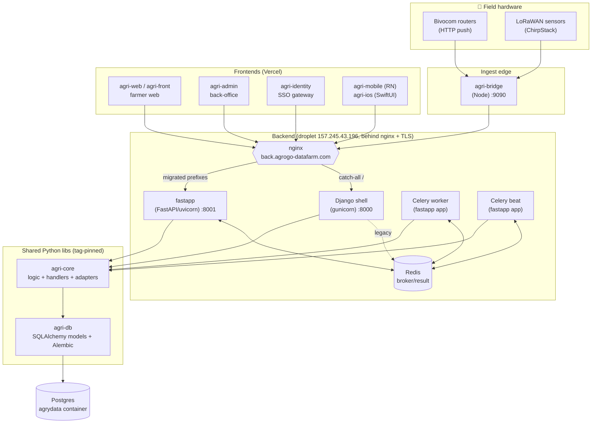
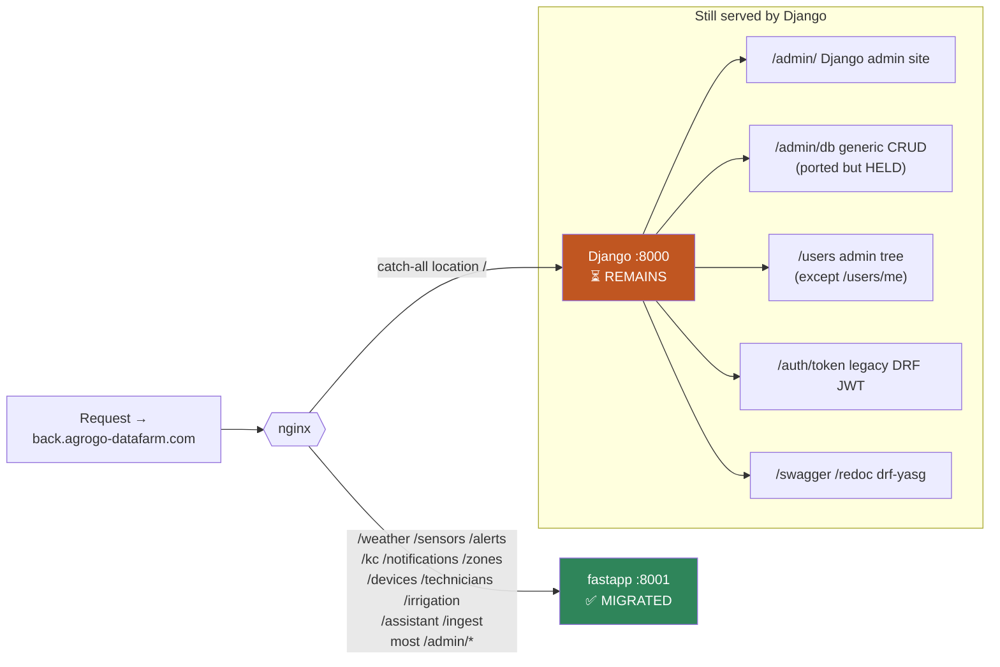
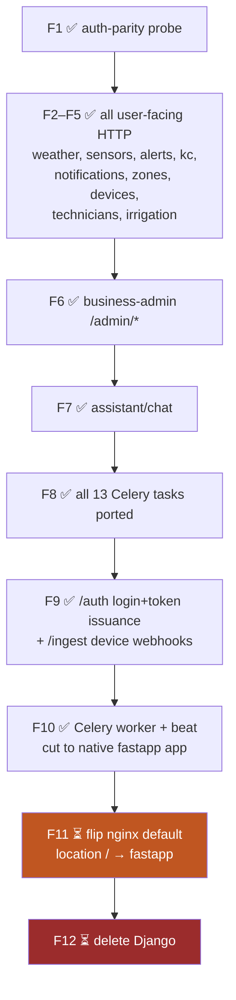
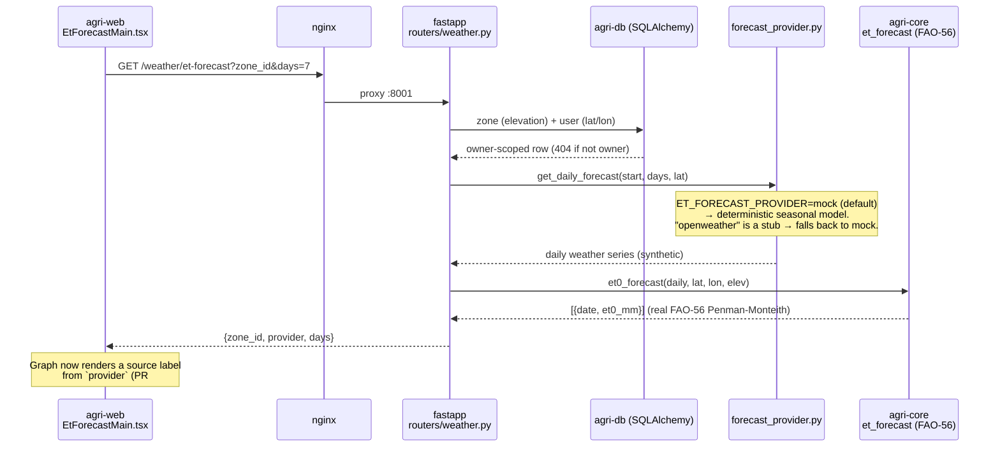
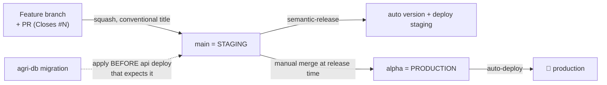

# AgriLogy — Architecture & Staff Handoff

> **Purpose.** One place for any engineer to understand how the platform fits
> together, what state the big migration is in, and where to pick up the next
> feature. All diagrams are Mermaid (render natively on GitHub).
>
> _Last updated: 2026-07-06._

---

## 1. Ecosystem at a glance

**One-way dependency rule:** `api → core → db`, pinned by git tag, released with
python-semantic-release. Frameworks (Django/DRF) are allowed only in `agri-api`;
`agri-core` and `agri-db` are framework-agnostic (SQLAlchemy only).

---

## 2. Repository map

| Repo | Role | Stack | Prod branch |
| --- | --- | --- | --- |
| **agri-api** | HTTP API + Celery. Mid-migration Django→FastAPI (see §3). | Python / Django + FastAPI | `alpha` |
| **agri-core** | Business logic, endpoint handlers, device adapters, FAO-56 agronomy math | Python / SQLAlchemy | tag |
| **agri-db** | Schema of record — SQLAlchemy models + Alembic chain | Python / Alembic | tag |
| **agri-bridge** | Device-uplink bridge (router push → backend ingest) | Node.js | — |
| **agri-web** | Farmer web app (Turborepo monorepo, `apps/web` + `@agri/*` packages) | Next.js | `alpha` |
| **agri-front** | Prior farmer web app (agri-web was extracted from it) | Next.js | `alpha` |
| **agri-admin** | Operations back-office console | Next.js | `main` |
| **agri-identity** | SSO gateway — single login, role-routed | Next.js | `main` |
| **agri-landing-page** | Public marketing site | Next.js | — |
| **agri-mobile** | Android/RN app | React Native / Expo | — |
| **agri-ios** | Native iOS app | Swift / SwiftUI | — |
| **shared-workflows** | Reusable CI workflows (called by every repo) | GitHub Actions | `main` |

---

## 3. The big migration — Django → FastAPI strangler ⚠️ (~95% done, live)

The backend is a **strangler-fig migration**: fastapp (native FastAPI, `:8001`)
progressively takes prefixes from the legacy Django shell (`:8000`). nginx is the
switch — each phase adds a `location` block routing one prefix to fastapp, above
the catch-all `location /` that still falls through to Django.

**Source of truth for routing:** `agri-api/deploy/nginx/back.conf` (applied
manually on the droplet — auto-sync is a tracked follow-up).

### Phase ledger

### What is LEFT in Django (the last ~5%)

Django is down to **one container** (`agri-api-web`). Worker + beat are fully on
fastapp. Everything below is reached only via the nginx catch-all:

| Surface | Why it's still on Django |
| --- | --- |
| `/admin/db/*` generic CRUD | **The real F12 blocker.** Ported to fastapp (`fastapp/routers/admin_db.py`, introspects SQLAlchemy metadata) but **HELD** — it can't reproduce Django's `verbose_name` / `help_text` / `choices` / `editable` field metadata that agri-admin's *Database* page renders. Core CRUD contract already byte-matches. |
| `/admin/` Django admin site | No fastapp equivalent; decide if staff still need the built-in admin UI. |
| `/users` admin tree (except `/users/me`) | fastapp has the router, but the `/users` prefix is shared with a still-Django users-admin router — the edge can't cleanly split it yet. |
| `/auth/token/*` legacy DRF SimpleJWT | Kept for older clients; new `/auth/sessions` + `/auth/signup` already on fastapp. |
| `/swagger`, `/redoc` (drf-yasg) | Low priority; FastAPI's built-in `/docs` can replace it. |

**Next two steps:**
1. **F11** — flip nginx `location /` default to fastapp; pin only `/admin/`,
   `/admin/db` (and optionally `/auth/token`) back to `:8000`. Lowest-risk step —
   every migrated path is already explicitly routed.
2. **F12** — delete Django, gated on: a field-metadata source for `/admin/db`,
   the `/admin/` site decision, and resolving the `/users` prefix split.

---

## 4. Data flow — ET₀ 7-day forecast (worked example)

The dashboard's **"ET₀ — prévision sur 7 jours"** widget is a good end-to-end
example of a fully-migrated feature. ⚠️ **Its weather input is currently
synthetic** (a deterministic mock), while the ET₀ math is real FAO-56.

**To make it a real forecast:** implement `_openweather_forecast` (or add an
Open-Meteo provider — no API key needed) in
`agri-api/back/src/apps/sensors/forecast_provider.py`, then set
`ET_FORECAST_PROVIDER` + `WEATHER_API_KEY`. The frontend label updates
automatically. This provider will move into `agri-core` in a later phase.

---

## 5. Background jobs (Celery)

All 13 tasks + beat run on the **native fastapp Celery app**
(`fastapp/celery_app.py`), queue `agriapi`. The old Django worker/beat are gone.

> Beat uses `DatabaseScheduler` — live cadences come from `PeriodicTask` rows,
> not the static code schedule. Real bug caught during F10: on-demand
> `send_task` must target the `agriapi` queue (fixed in #361).

---

## 6. Release & deploy flow

- **`main` = staging** — every merge auto-deploys + cuts a semantic-release version.
- **`alpha` = production** — promoted manually (`main` → `alpha`); never auto-synced.
- PR titles must be Conventional Commits (enforced) — they become release commits.
- **Schema order:** apply agri-db migrations *before* deploying the agri-api that needs them.
- Shared CI lives in `shared-workflows`.

---

## 7. Where to pick up next — feature backlog

Grouped by area. Items marked ⚠️ are the highest-leverage / already-scoped.

**Backend migration (finish the strangler)**
- ⚠️ **F11** — nginx default flip to fastapp (see §3).
- **F12** — delete Django; first unblock `/admin/db` field metadata.
- Auto-sync `deploy/nginx/back.conf` into the deploy pipeline (currently manual).

**Weather / agronomy**
- ⚠️ **Real ET₀ forecast provider** — wire Open-Meteo (keyless) or OpenWeather in
  `forecast_provider.py`; replaces the demo mock (§4).
- Move the forecast provider into `agri-core`.

**Notifications & alerts**
- Per-alert channel matrix (email/SMS/WhatsApp) — partly built.
- Custom notification zones / geofencing.
- Resend daily-quota ceiling — periodic emails 429 on the free tier; raise plan.

**Product**
- Chatbot assistant — swap the mock engine for the real backend (`/assistant/*`
  routers already exist on fastapp).
- agri-admin `/admin/db` field-metadata source (unblocks F12 too).

**Platform / ops**
- Droplet has **no firewall** — Postgres 5432, Redis 6379, Adminer 8080 are
  publicly exposed. Add a DO Cloud Firewall.
- Prod DB is the `agrydata` Postgres container on the droplet; eventual cutover to
  managed/Supabase is deferred.

---

## 8. Getting started (any repo)

1. **Clone siblings side-by-side** — `agri-api`, `agri-core`, `agri-db` expect to
   sit in the same parent dir (tag-pinned git deps; core needs a PAT for the
   private `agri-db` package).
2. **Schema first:** `cd agri-db && make upgrade-dev` **before** `cd agri-api && make up`.
3. **Never** run `manage.py migrate` in agri-api — schema is owned by agri-db/Alembic.
4. **PR rules:** one issue per PR (`Closes #N`, both assigned to the author);
   Conventional-Commit titles; branch off `main`.
5. Each repo's `CLAUDE.md` + `.claude/` holds repo-specific gotchas.

---

_See each repo's `CLAUDE.md` and `docs/` for depth. This file is the map, not the
territory — keep it current when a phase lands._
