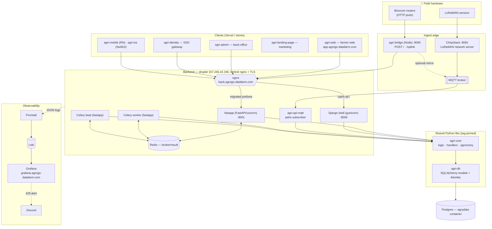
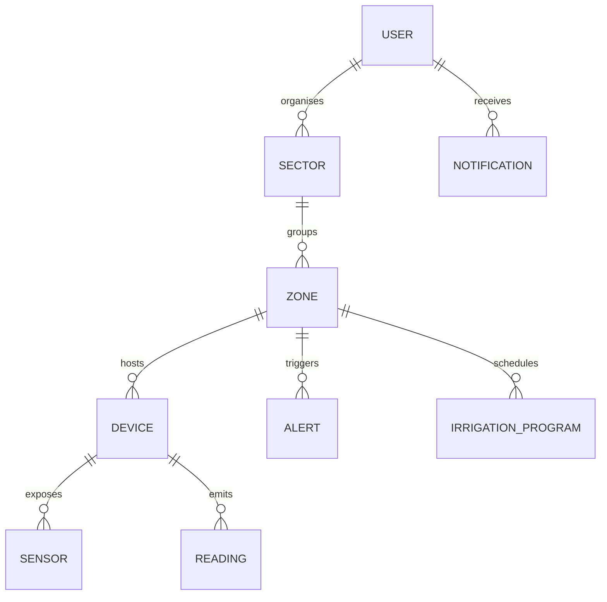
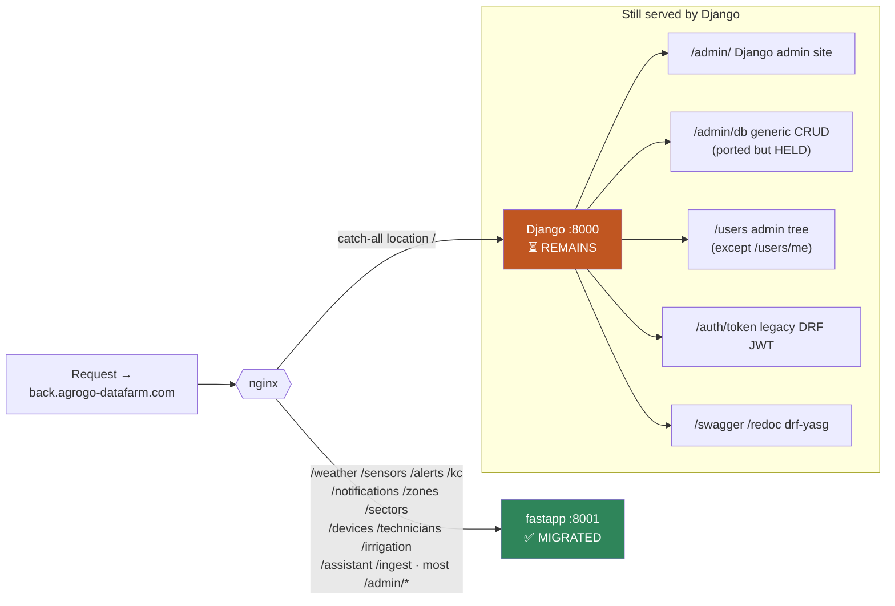
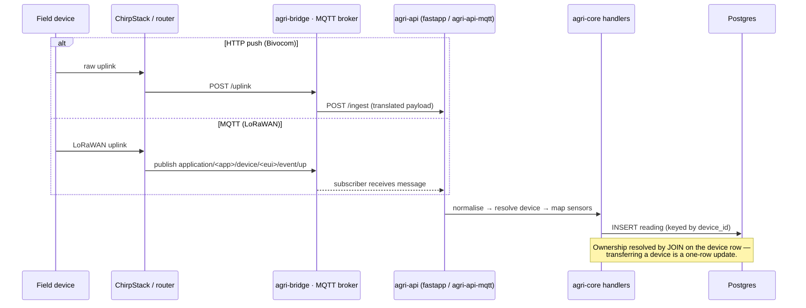
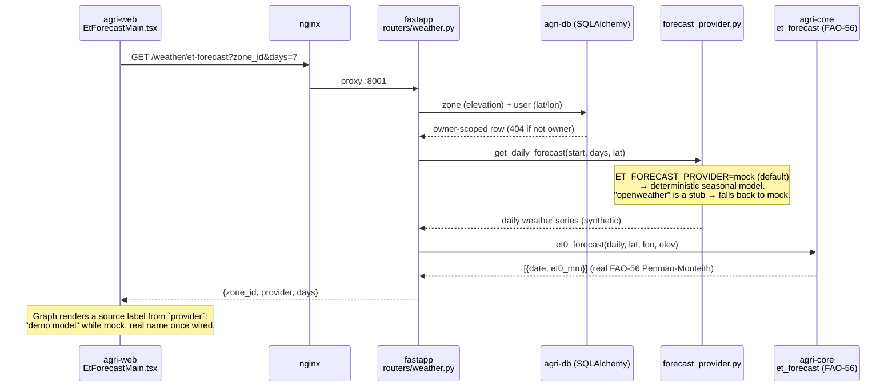
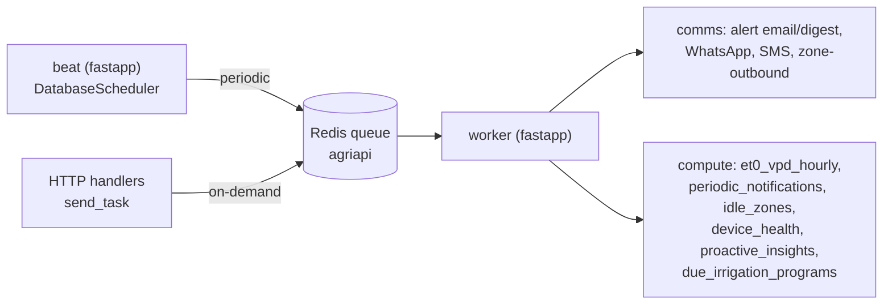
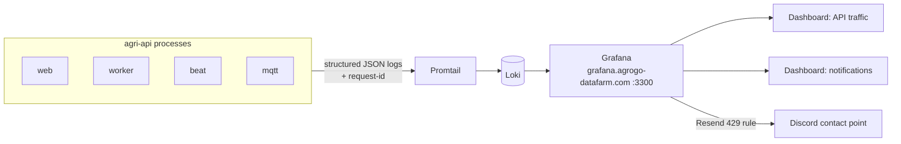
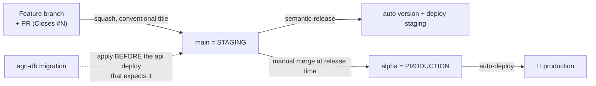
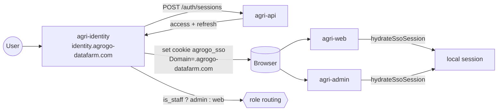

# AgriLogy — Architecture & Staff Handoff

> **Purpose.** One place for any engineer to understand how the platform fits
> together, what state the big migration is in, and where to pick up the next
> feature. All diagrams are Mermaid (render natively on GitHub).
>
> Per-repo build/test/PR instructions live in each repo's `CONTRIBUTING.md`.
> This file is the map; those files are the ground.
>
> _Last updated: 2026-07-23._

---

## 1. Ecosystem at a glance

**One-way dependency rule:** `api → core → db`, pinned by git tag, released with
python-semantic-release. Frameworks (Django/DRF/FastAPI) are allowed only in
`agri-api`; `agri-core` and `agri-db` are framework-agnostic (SQLAlchemy only).
`agri-db` is the **schema of record** — nothing else may create or alter tables.

---

## 2. Repository map

| Repo | Role | Stack | Prod branch |
| --- | --- | --- | --- |
| **agri-api** | HTTP API + Celery + MQTT subscriber. Mid-migration Django→FastAPI (§4). | Python / Django + FastAPI | `alpha` |
| **agri-core** | Business logic, endpoint handlers, device adapters, FAO-56 agronomy math | Python / SQLAlchemy | tag |
| **agri-db** | Schema of record — SQLAlchemy models + the Alembic chain | Python / Alembic | tag |
| **agri-bridge** | Device-uplink bridge (router push → backend ingest) | Node.js | — |
| **agri-web** | ★ The farmer web app (Turborepo: `apps/web` + `@agri/*`) | Next.js | `alpha` |
| **agrilogy-front** | Predecessor farmer web app — **maintenance only**, superseded by agri-web | Next.js | `alpha` |
| **agri-admin** | Operations back-office console | Next.js | `main` |
| **agri-identity** | SSO gateway — single login, role-routed | Next.js | `main` |
| **agri-landing-page** | Public marketing site | Next.js | `main` |
| **agri-mobile** | Android app | React Native / Expo | `main` |
| **agri-ios** | Native iOS app | Swift / SwiftUI / XcodeGen | `main` |
| **shared-workflows** | Reusable CI workflows called by the other repos (`@v1`) | GitHub Actions | `main` |
| **python-template** | Starting point for new Python repos | Python / uv | `main` |
| **.github** | Org profile, default PR template, this document | Markdown | `main` |

Every repo carries a `CONTRIBUTING.md` at its root with the exact setup, dev-loop
and CI commands for that repo.

---

## 3. Domain model — who owns what data

- One farm per user. **Sector** is a purely organisational grouping (no geometry)
  sitting between the user and their zones; `/sectors` CRUD +
  `PUT /sectors/{id}/zones` + `/sectors/overview` back the `/farm` page in agri-web.
- **Ownership is device-keyed.** Readings are keyed by `device_id`; who owns a
  reading is resolved by joining the device row. Transferring a device between
  accounts is therefore a one-row update, not a data migration.

---

## 4. The big migration — Django → FastAPI strangler ⚠️ (~95% done, live)

The backend is a **strangler-fig migration**: fastapp (native FastAPI, `:8001`)
progressively takes prefixes from the legacy Django shell (`:8000`). nginx is the
switch — each phase adds a `location` block routing one prefix to fastapp, above
the catch-all `location /` that still falls through to Django.

**Source of truth for routing:** `agri-api/deploy/nginx/back.conf` (applied
manually on the droplet — auto-sync is a tracked follow-up).

### Phase ledger

### What is LEFT in Django (the last ~5%)

Django is down to **one container** (`agri-api-web`). Worker, beat and the MQTT
subscriber are fully on fastapp. Everything below is reached only via the nginx
catch-all:

| Surface | Why it's still on Django |
| --- | --- |
| `/admin/db/*` generic CRUD | **The real F12 blocker.** Ported to fastapp (`fastapp/routers/admin_db.py`, introspects SQLAlchemy metadata) but **HELD** — it can't reproduce Django's `verbose_name` / `help_text` / `choices` / `editable` field metadata that agri-admin's *Database* page renders. Core CRUD contract already byte-matches. |
| `/admin/` Django admin site | No fastapp equivalent; decide if staff still need the built-in admin UI. |
| `/users` admin tree (except `/users/me`) | fastapp has the router, but the `/users` prefix is shared with a still-Django users-admin router — the edge can't cleanly split it yet. |
| `/auth/token/*` legacy DRF SimpleJWT | Kept for older clients; new `/auth/sessions` + `/auth/signup` already on fastapp. |
| `/swagger`, `/redoc` (drf-yasg) | Low priority; FastAPI's built-in `/docs` can replace it. |

**Next two steps:**
1. **F11** — flip nginx `location /` default to fastapp; pin only `/admin/`,
   `/admin/db` (and optionally `/auth/token`) back to `:8000`. Lowest-risk step —
   every migrated path is already explicitly routed.
2. **F12** — delete Django, gated on: a field-metadata source for `/admin/db`,
   the `/admin/` site decision, and resolving the `/users` prefix split.

---

## 5. Ingest — two transports, one pipeline

HTTP push was first; MQTT was added **additively** — same handlers, same
ownership rules, different transport.

> A device is moved from HTTP to MQTT by deleting its ChirpStack HTTP
> integration. **MQTT is now the only route from ChirpStack** —
> `application_integration` holds no HTTP rows. `MQTT_HOST` lives in
> `/root/agri-api/.env` (the compose-project env file; compose `environment:`
> overrides `back/.env`, so editing the repo one changes nothing).
> `agri-api-mqtt` is **not** recreated by the deploy workflow — force-recreate it
> after each deploy (see `agri-api/CONTRIBUTING.md`).

---

## 5b. Operational state — what is actually live

_Snapshot 2026-07-23. Established by read-only investigation; keep it honest._

**There are exactly two real hardware feeds in production.** Everything else in
the database is simulated or seeded — a fact worth knowing before trusting a
dashboard.

| Feed | Owner | Transport | State |
| --- | --- | --- | --- |
| Router02 **weather** (wind, temp, humidity, pressure, solar) | user 4 / zone 1 | Bivocom HTTP → `agryserver:9090` → legacy `agrybackend` | ✅ live |
| ET₀ / VPD for zone 1 (derived) | user 4 / zone 1 | Celery `compute_et0_vpd_hourly` | ✅ live |
| Router02 **soil probe** (moisture / temp / EC × low+medium) | user 4 / zone 1 | same Bivocom path, separate POST stream | ❌ dead since 2026-07-13 14:01 — field hardware |
| LoRa node `ph` (`a840412ca45d64d0`) | user 8 / zone 11 | ChirpStack → MQTT → `agri-api-mqtt` | ❌ dead since 2026-07-13 15:13 — gateway off air |
| Simulator, ~30 tables, zones 6 & 7 | user 1 | Celery `simulate_sensor_ingest` | ⏹ retired by the F10 beat cutover |

Two independent failures 72 minutes apart, neither of them a software bug, and
**nothing alerted** — because device-health scanning was itself broken and the
one real Bivocom router is not registered in `analytics_device` at all. Staleness
alerting on `max(received_at)` is the gap to close: it is transport-agnostic and
catches hardware failure, which no log-based alert can.

### Schema drift — the shape of a recurring bug class

Production is **stamped 12 revisions behind** the Alembic head, but physically
almost current: most intervening objects were applied out-of-band by the old
ensure-scripts. Only two are genuinely missing — `analytics_devicesensor`, and
`analytics_device.latitude`/`.longitude`.

Both are referenced by live code. Only one caused incidents:

| Reference | Guarded? | Outcome |
| --- | --- | --- |
| `sectors.py::farm_overview` → `analytics_devicesensor` | ✅ `begin_nested()` SAVEPOINT, degrades to "no configured captors" | absent for weeks, endpoint fine |
| device coordinates, several call sites | ❌ raw select, no fallback | three separate production defects |

**The rule this implies:** any code touching an object whose migration has not
been applied to production must degrade, not raise. Copy the `sectors.py`
SAVEPOINT pattern, or the cached probe in `fastapp/schema_compat.py`. Better
still, apply the migration — the pending revisions use idempotent DDL, so the
cutover creates only those two missing objects.

---

## 6. Data flow — ET₀ 7-day forecast (worked example)

The dashboard's **"ET₀ — prévision sur 7 jours"** widget is a good end-to-end
example of a fully-migrated feature. ⚠️ **Its weather input is currently
synthetic** (a deterministic mock), while the ET₀ math is real FAO-56.

**To make it a real forecast:** implement `_openweather_forecast` (or add an
Open-Meteo provider — no API key needed) in
`agri-api/back/src/apps/sensors/forecast_provider.py`, then set
`ET_FORECAST_PROVIDER` + `WEATHER_API_KEY`. The frontend label updates
automatically. This provider will move into `agri-core` in a later phase.

---

## 7. Background jobs (Celery)

All 13 tasks + beat run on the **native fastapp Celery app**
(`fastapp/celery_app.py`), queue `agriapi`. The old Django worker/beat are gone.

> Beat uses `DatabaseScheduler` — live cadences come from `PeriodicTask` rows,
> not the static code schedule. On-demand `send_task` must target the `agriapi`
> queue. Outbound email goes over Resend's HTTPS API (the droplet blocks SMTP);
> quota exhaustion surfaces as a `quota_exceeded` log event and a Grafana alert.

---

## 8. Observability

Stack lives in `agri-api/deploy/observability/` on its own compose file.
`LOG_LEVEL` / `LOG_FORMAT` are the knobs; log rotation is configured on the app
compose.

---

## 9. Release & deploy flow

- **`main` = staging** — every merge auto-deploys + cuts a semantic-release version.
- **`alpha` = production** — promoted manually (`main` → `alpha`); never auto-synced.
- PR titles must be Conventional Commits (enforced) — they become release commits.
- **Release order across repos:** `agri-db` → `agri-core` → `agri-api`; downstream
  repos pin upstream by git tag.
- **Schema order:** apply agri-db migrations *before* deploying the agri-api that
  needs them.
- Shared CI lives in `shared-workflows`, consumed as `@v1`.

### Environments

| Environment | Frontend | Backend | Database |
| --- | --- | --- | --- |
| local | `npm run dev` | `make up` (compose) | local Postgres via agri-db |
| staging | Vercel preview / staging project | agri-api `*-staging` stack on the droplet (`:90xx`) | `agrydata-staging` |
| production | Vercel prod (`app.` / `admin.` / `identity.`) | agri-api stack behind `back.agrogo-datafarm.com` | `agrydata` |

> The staging tier is **decided but not yet built** — same-droplet separate stack
> at `staging.agrogo-datafarm.com`, gated on DNS, Vercel envs and branch-strategy
> sign-off.

---

## 10. Auth & SSO

The cookie is deliberately **not** httpOnly so sibling apps can adopt it
client-side; it is `secure`, `sameSite=lax`, scoped to the shared parent domain —
which is also why cross-app SSO cannot be exercised on `localhost`. Adding a new
consumer app means adding its origin to the backend's CORS/CSRF allowlists.
A staff account can force-logout any user: `sessions_revoked_at` invalidates every
token issued before that instant.

---

## 11. Contributing

Every repo has a root `CONTRIBUTING.md` with its verified setup, dev loop, layout,
a worked example, CI and deploy path. Platform-wide rules:

1. **Clone siblings side-by-side** — `agri-api`, `agri-core`, `agri-db` expect to
   sit in the same parent dir (tag-pinned git deps; a PAT is needed to fetch the
   private `agri-db` package).
2. **Schema first:** `cd agri-db && make upgrade-dev` **before** `cd agri-api && make up`.
3. **Never** run `manage.py migrate` in agri-api — schema is owned by agri-db/Alembic.
4. **PR rules:** one dedicated, scope-matched issue per PR (`Closes #N`), issue and
   PR both assigned to the author; Conventional-Commit titles; branch off `main`.
5. Every board item carries a **Size + Estimate** weight — set it when the ticket
   is created, not after the fact.
6. Each repo's `CLAUDE.md` + `.claude/` holds repo-specific gotchas.

---

## 12. Where to pick up next

**Backend migration (finish the strangler)**
- ⚠️ **F11** — nginx default flip to fastapp (§4).
- **F12** — delete Django; first unblock `/admin/db` field metadata.
- Auto-sync `deploy/nginx/back.conf` into the deploy pipeline (currently manual).

**Platform**
- ⚠️ **Staging environment** — build the decided preprod tier (§9).
- **User-management RBAC** — Admin / Editor / Monitor tiers across db → api →
  admin → web; migration held.
- Droplet has **no firewall** — Postgres 5432, Redis 6379, Adminer 8080 are
  publicly exposed. Add a DO Cloud Firewall.
- Deploy leaves the Celery worker/beat containers stranded in `created`; the fix is
  a `start_period` on the web healthcheck.

**Weather / agronomy**
- ⚠️ **Real ET₀ forecast provider** — wire Open-Meteo (keyless) or OpenWeather in
  `forecast_provider.py`; replaces the demo mock (§6).
- Move the forecast provider into `agri-core`.

**Notifications & alerts**
- Per-alert channel matrix (email/SMS/WhatsApp) — partly built.
- Custom notification zones / geofencing.
- Resend daily-quota ceiling — periodic emails 429 on the free tier.

**Product**
- Chatbot assistant — swap the mock engine for the real backend (`/assistant/*`
  routers already exist on fastapp).
- Header Sector·Zone picker across the web app (§3).
- agri-mobile: output-command API + push/FCM are the two backend gaps.

---

_See each repo's `CONTRIBUTING.md`, `CLAUDE.md` and `docs/` for depth. This file is
the map, not the territory — keep it current when a phase lands._
