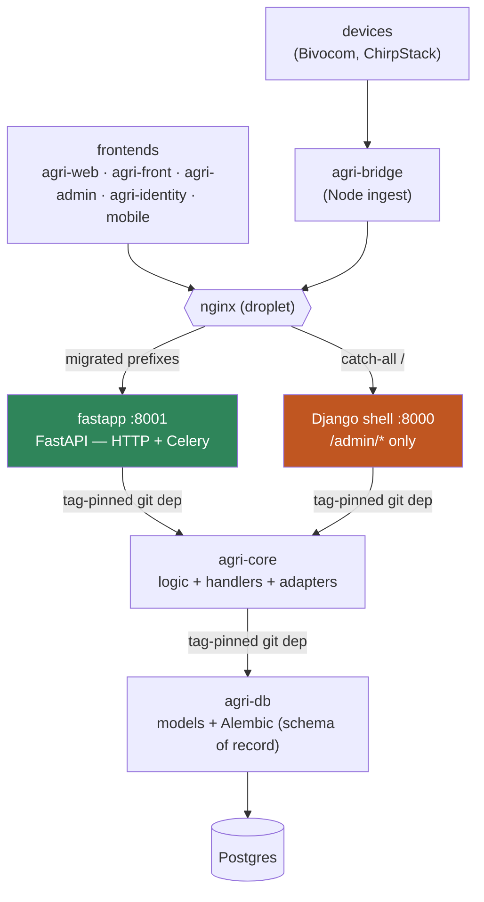

# AgriLogy

Smart-farming platform: field sensors (Bivocom routers, LoRaWAN/ChirpStack) → ingestion → agronomy analytics (ET, irrigation, alerts) → farmer web/mobile apps and an operations back-office.

> 📐 **New here?** Read [**ARCHITECTURE.md**](../ARCHITECTURE.md) — full Mermaid
> diagrams, the Django→FastAPI migration status, data-flow walkthroughs, and the
> feature backlog to pick up from.

## Repository map

| Repo | What it is | Stack |
| --- | --- | --- |
| [agri-api](https://github.com/AgriLogy/agri-api) | Backend API + Celery. **Mid-migration Django→FastAPI (~95% done)** — native FastAPI (`fastapp`) serves all traffic + jobs; a thin Django shell remains for `/admin/*`. See [ARCHITECTURE.md](../ARCHITECTURE.md). | Python / FastAPI + Django |
| [agri-core](https://github.com/AgriLogy/agri-core) | Business logic, endpoint handlers, device adapters, FAO-56 agronomy math — framework-agnostic library | Python / SQLAlchemy |
| [agri-db](https://github.com/AgriLogy/agri-db) | Schema of record: SQLAlchemy models + Alembic migration chain | Python / Alembic |
| [agri-bridge](https://github.com/AgriLogy/agri-bridge) | Device-uplink bridge (router push → backend ingest) | Node.js |
| [agri-web](https://github.com/AgriLogy/agri-web) | Farmer web app (Turborepo monorepo) | Next.js |
| [agri-front](https://github.com/AgriLogy/agrilogy-front) | Prior farmer web app (agri-web was extracted from it) | Next.js |
| agri-admin | Operations back-office console | Next.js |
| agri-identity | SSO gateway (single login, role-routed) | Next.js |
| agri-mobile / agri-ios | Native mobile apps (Android RN / iOS SwiftUI) | RN · Swift |
| [agri-landing-page](https://github.com/AgriLogy/agri-landing-page) | Public marketing site | Next.js |

## Architecture (3-tier backend)

Dependencies flow one way: **api → core → db**, pinned by git tag and released with python-semantic-release. Shared CI lives in [shared-workflows](https://github.com/AgriLogy/shared-workflows). The backend is mid-strangler — see [**ARCHITECTURE.md**](../ARCHITECTURE.md) for the full migration status and phase ledger.

## Release flow

- **`main` = staging** — every merge auto-deploys to staging and cuts a semantic-release version from conventional commits.
- **`alpha` = production** — promoted manually by merging `main` → `alpha` at release time; `alpha` auto-deploys to production.
- Squash-merge titles must be Conventional Commits (enforced by the PR-title gate) — they become the release commits.
- **Deploy order for schema changes:** apply agri-db migrations **before** deploying the agri-api version that expects them.
